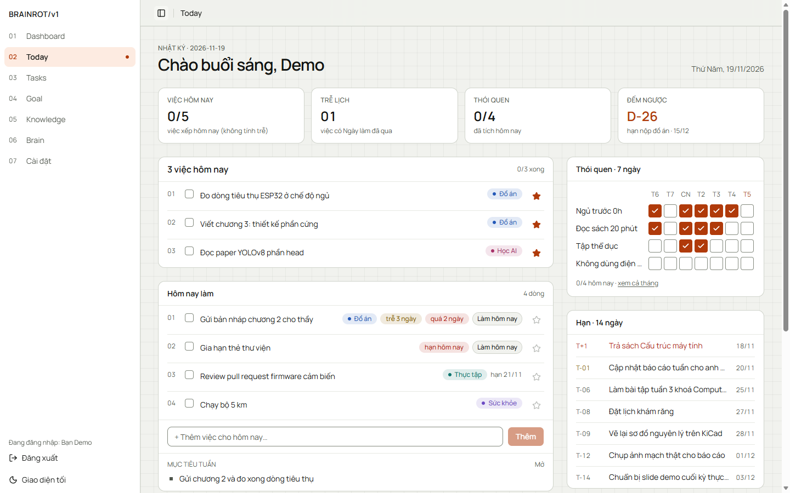
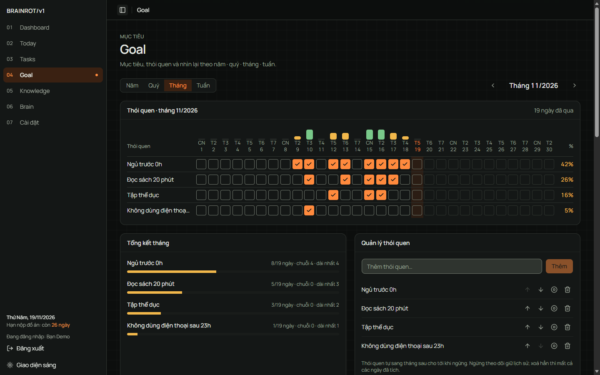

# Brainrot — Second Brain Web

Web gom **việc, mục tiêu, thói quen và ghi chú kiến thức** về một chỗ. Mở ra là biết hôm nay làm gì, tuần này đang ra
sao, đang hướng tới mục tiêu nào, đã học được gì.

- **Bản đang chạy:** <https://brainrot-blue.vercel.app> (mỗi người một tài khoản email + mật khẩu, không có trang tự đăng ký)
- **Phiên bản:** v1.2 (19/11/2026) — thêm "3 việc hôm nay" và chia mục tiêu tháng xuống tuần trên nền v1.1 (tag `v1.1.0`)
- **Ngôn ngữ / múi giờ:** giao diện tiếng Việt, mọi phép tính ngày theo Asia/Ho_Chi_Minh

> Dự án cá nhân của một sinh viên năm 4 PTIT, viết cùng AI agent. Repo private.

| Today (sáng) | Goal · Tháng (tối) |
|---|---|
|  |  |

_Ảnh chụp tài khoản demo (`npm run demo:seed`), 1440×900._

## Mục lục

- [Tính năng](#tính-năng)
- [Công nghệ](#công-nghệ)
- [Chạy trên máy](#chạy-trên-máy)
- [Biến môi trường](#biến-môi-trường)
- [Lệnh npm](#lệnh-npm)
- [Kiểm thử](#kiểm-thử)
- [Database](#database)
- [Deploy lên Vercel](#deploy-lên-vercel)
- [Cấu trúc thư mục](#cấu-trúc-thư-mục)
- [Tài liệu](#tài-liệu)
- [Khi có lỗi](#khi-có-lỗi)
- [Quy trình đóng góp](#quy-trình-đóng-góp)

## Tính năng

| Trang | Câu hỏi nó trả lời | Nội dung chính |
|---|---|---|
| **Today** | Hôm nay làm gì? | **3 việc hôm nay** (☆, tối đa 3, chọn từ tối hôm trước) · **Hôm nay làm** (Ngày làm hôm nay, việc trễ, hạn hôm nay) · hạn 14 ngày · thói quen 7 ngày · kiến thức mới · Ghi nhanh ý tưởng · Cuối ngày (Daily Log, chọn việc ngày mai). Ngày làm việc đổi lúc 4:00 |
| **Tasks** | Tôi có những việc gì? | Nơi **duy nhất** tạo, sửa, xoá việc: nhóm theo dự án, lọc dự án / ưu tiên, Deadline, **Ngày làm**, gắn mục tiêu |
| **Goal** | Tôi đang hướng tới điều gì? | Mục tiêu **Năm → Quý → Tháng → Tuần**, tự xong theo thói quen / việc; **chia mục tiêu tháng xuống tuần** (chip x/y); bảng thói quen; 7 thẻ ngày của tuần (dời việc); chuyển mục tiêu sang kỳ sau; Nhìn lại 4 câu + châm ngôn năm |
| **Dashboard** | Tôi đang làm tốt không? | Thẻ "Tuần này" kết luận một câu · 4 KPI · việc theo dự án · mục tiêu tháng · sắp đến hạn · nhịp làm & học · nhịp hằng ngày (kèm "3 việc: N/M ngày xong hết") · thói quen. Kỳ 7 / 30 / 90 ngày, công tắc **Thật / Mẫu** |
| **Knowledge** | Tôi đã học được gì? | Ghi chú theo **Lĩnh vực** và mức hiểu (Mới học / Hiểu / Áp dụng được), tóm tắt, link nguồn, nối ghi chú **liên quan tới** nhau; lọc và tìm không dấu |
| **Brain** | Mọi thứ nối với nhau thế nào? | Graph 3D kiểu neuron: lĩnh vực, ghi chú, dự án, việc chưa xong và liên kết; tìm không dấu (phím `/`), bấm node mở trang |
| **Cài đặt** | | Tên, hạn đếm ngược, dự án, lĩnh vực, đổi mật khẩu, xoá tài khoản |

**Mô hình nghiệp vụ:** một chuỗi **Goal → Task → Ngày**. Tasks là kho việc duy nhất; Goal gồm các Task; Task xếp vào
ngày bằng **Ngày làm** (ngày định làm, khác **Deadline** là ngày phải xong); thói quen làm Goal tự xong.

Mọi thao tác xoá / dời / tích xong có toast **Hoàn tác** 8 giây. Theme sáng / tối theo hệ điều hành, nhớ lựa chọn.
Chi tiết hành vi từng màn: [`SPEC.md`](SPEC.md) mục 5.

## Công nghệ

| Phần | Dùng |
|---|---|
| Framework | Next.js 16 (App Router, Server Components, Server Actions) · React 19 · TypeScript strict |
| Giao diện | Tailwind CSS v4 · shadcn/ui + [ReUI](https://reui.io) · biểu đồ SVG tự vẽ (`components/dashboard/charts.tsx`) · `react-force-graph-3d` + three.js (chỉ trang Brain) |
| Dữ liệu | Drizzle ORM · Neon Postgres |
| Đăng nhập | Tự viết: mật khẩu băm scrypt, cookie phiên ký HMAC (`lib/auth.ts`, `lib/session.ts`), không dùng auth library |
| Kiểm thử | Vitest; truy vấn database chạy trên PGlite (Postgres trong bộ nhớ) |
| Hosting | Vercel (tự deploy khi push lên `main`) |

```
Trình duyệt ──► Next.js trên Vercel (Server Components + Server Actions)
                   ├── proxy.ts: chưa có cookie hợp lệ → /login?next=<trang đang mở>
                   ├── lib/auth.ts, lib/session.ts: cookie phiên HMAC chứa userId
                   └── lib/db/: MỌI truy vấn, luôn lọc theo userId ──► Postgres (Neon)
```

## Chạy trên máy

**Cần có:**

- **Node.js ≥ 22.18** (khuyên dùng 24 LTS). Script `user:password` import thẳng file `.ts`, cần Node tự bỏ kiểu
  TypeScript (có sẵn từ 22.18).
- Một database **Postgres**: Neon gói miễn phí (tạo qua Vercel → Storage → Neon hoặc <https://neon.tech>).

**Các bước:**

```bash
git clone https://github.com/trungKoiKa/Brainrot.git
cd Brainrot
npm install
cp .env.example .env.local                 # rồi điền DATABASE_URL, AUTH_SECRET (xem mục dưới)
npm run db:migrate                         # tạo bảng trong database
npm run user:password -- <email> "<tên>"   # tạo tài khoản; script hỏi mật khẩu (gõ ẩn)
npm run dev                                # http://localhost:3000
```

Muốn có sẵn dữ liệu để xem thử: `npm run demo:seed` tạo tài khoản `demo@example.com` đầy dữ liệu mẫu (chưa có mật
khẩu; đặt bằng `npm run user:password -- demo@example.com` để đăng nhập).

## Biến môi trường

Đặt trong `.env.local` (máy) hoặc Project Settings → Environment Variables (Vercel). Mẫu: [`.env.example`](.env.example).

| Biến | Bắt buộc | Ý nghĩa |
|---|---|---|
| `DATABASE_URL` | ✓ | Chuỗi kết nối Postgres (**bí mật**). Trên Vercel do Neon integration tự thêm |
| `AUTH_SECRET` | ✓ | Chuỗi ngẫu nhiên ≥ 32 ký tự để ký cookie (**bí mật**). Tạo: `node -e "console.log(require('crypto').randomBytes(32).toString('base64url'))"` |
| `THESIS_DEADLINE` | | Hạn mặc định (`YYYY-MM-DD`) cho thẻ đếm ngược của người dùng đầu tiên khi chưa đặt hạn ở Cài đặt |

`.env.local` đã nằm trong `.gitignore` — **không bao giờ commit**. Các biến `GOOGLE_*`, `NOTION_*`, `APP_PASSWORD` cũ
không còn được đọc (Calendar đã bỏ khỏi phạm vi, `SPEC.md` mục 9).

## Lệnh npm

| Lệnh | Làm gì |
|---|---|
| `npm run dev` | Chạy dev server ở <http://localhost:3000> |
| `npm run build` / `npm start` | Build production / chạy bản đã build |
| `npm run lint` | ESLint |
| `npm test` | Vitest (một lần, không watch) |
| `npm run db:generate` | Sinh migration sau khi sửa `lib/db/schema.ts` (commit file migration sinh ra) |
| `npm run db:migrate` | Áp migration vào database trong `DATABASE_URL` |
| `npm run db:studio` | Mở Drizzle Studio xem bảng |
| `npm run user:password -- <email> ["Tên"]` | Tạo tài khoản mới hoặc đặt lại mật khẩu (mật khẩu không bao giờ in ra) |
| `npm run demo:seed` | Tạo / làm mới tài khoản demo; `-- --remove` để xoá hẳn. Chỉ đụng dữ liệu của user demo |

Các lệnh `db:*`, `user:password`, `demo:seed` đọc `.env.local` qua `node --env-file`.

## Kiểm thử

```bash
npm run lint
npm test
npm run build
```

Ba lệnh này không lỗi là điều kiện để merge. Test đặt cạnh code (`*.test.ts`): hàm thuần ở `lib/`, truy vấn ở `lib/db/`
chạy trên PGlite (không cần database thật), có test **cách ly giữa hai người dùng**. Thay đổi giao diện cần thêm ảnh
thật 1440×900 ở cả hai theme trên tài khoản demo (`SPEC.md` mục 8).

## Database

- Bảng và cột: [`lib/db/schema.ts`](lib/db/schema.ts); tóm tắt ở [`SPEC.md`](SPEC.md) mục 3.
- Migration: `lib/db/migrations/` (sửa schema → `npm run db:generate` → commit → `npm run db:migrate`).
- Mọi bảng có `user_id` → `users.id` **ON DELETE CASCADE**: xoá tài khoản là xoá sạch dữ liệu của người đó.
- Dev và production dùng chung một database Neon, nên migration chỉ nên **thêm** cột / bảng (không đổi cột cũ) để bản
  đang chạy không vỡ.
- Kiểm migration đã áp chưa: xem bảng `drizzle.__drizzle_migrations`.

## Deploy lên Vercel

1. <https://vercel.com/new> → **Import** repo này (Vercel tự nhận Next.js).
2. **Storage → Neon** → nối project cho các môi trường cần dùng (không tick "Create Database Branch" nếu muốn dùng
   chung một database). Thêm `AUTH_SECRET` mới (và `THESIS_DEADLINE` nếu cần).
3. Áp migration vào database đó (`npm run db:migrate` với `DATABASE_URL` của nó) và tạo tài khoản bằng
   `npm run user:password`.
4. **Deploy**. Từ đó mỗi lần push lên `main` Vercel tự deploy lại; đổi biến môi trường thì **Redeploy**.

## Cấu trúc thư mục

```
app/(app)/<màn>/   Trang sau đăng nhập: dashboard, today, tasks, goals, knowledge, brain, settings
                   (page.tsx chỉ đọc dữ liệu và ghép thẻ; error.tsx báo "Không lấy được dữ liệu")
app/login/         Đăng nhập
app/actions/       Server Actions: kiểm tra đăng nhập → kiểm tra đầu vào → runWrite() (lib/db/actions-db.ts)
proxy.ts           Chặn route khi chưa đăng nhập (Next 16: tên mới của middleware)
lib/db/            Mọi truy vấn Postgres (server-only), mỗi màn một file; schema, migrations; mọi hàm lọc theo userId
lib/               Hàm thuần có test đặt cạnh: date (giờ VN), today, period, goals, habits, focus, knowledge, text…;
                   dashboard/ (số liệu), graph/ (dữ liệu Brain)
components/<màn>/  Giao diện riêng từng màn; file nằm thẳng trong components/ là thứ dùng chung
                   (card, pill, readout, deadline-field…); ui/ (shadcn), reui/ (ReUI)
hooks/             Hook dùng chung
scripts/           set-password.mjs (user:password), seed-demo.mjs (demo:seed)
docs/              Hướng dẫn, quyết định kỹ thuật, plan, SPEC cũ, rà soát và ảnh chụp
```

## Tài liệu

| File | Nội dung |
|---|---|
| [`SPEC.md`](SPEC.md) | **Nguồn sự thật duy nhất** về phạm vi và hành vi sản phẩm; mục 11 là nhật ký quyết định |
| [`docs/huong-dan.md`](docs/huong-dan.md) | Hướng dẫn sử dụng hằng ngày / tuần / tháng và luồng dữ liệu bên trong |
| [`DESIGN.md`](DESIGN.md) · [`PRODUCT.md`](PRODUCT.md) | Hệ thống giao diện ("Nhật ký kỹ thuật") và bản ghi sản phẩm cho skill thiết kế Impeccable |
| [`docs/decisions/`](docs/decisions/) | Quyết định kỹ thuật lâu dài (Postgres + Drizzle + userId, đăng nhập email/mật khẩu, màu lĩnh vực…) |
| [`docs/plans/`](docs/plans/) | Plan từng phiên bản: `active/` đang chạy, `completed/` đã xong (v0.1 → v1.2) |
| [`docs/specs/archive/`](docs/specs/archive/) | SPEC các bản cũ v0.1 → v1.0, giữ nguyên văn |
| [`docs/audits/`](docs/audits/) | Rà soát UI / UX / a11y / hiệu năng 11/2026 và ảnh chụp bằng chứng |
| [`AGENTS.md`](AGENTS.md) | Quy tắc cho AI agent (Claude Code, Codex…); `CLAUDE.md` chỉ import file này |

## Khi có lỗi

| Hiện tượng | Nguyên nhân thường gặp |
|---|---|
| Trang "Không lấy được dữ liệu" | Không đọc được database: sai `DATABASE_URL`, mất mạng, hoặc Neon đang khởi động lại sau khi ngủ |
| Đăng nhập báo sai email hoặc mật khẩu | Chưa tạo tài khoản / quên mật khẩu → `npm run user:password -- <email>` đặt lại |
| Đăng nhập bị khoá tạm | Sai mật khẩu 5 lần trong 15 phút → đợi 15 phút |
| Lỗi thiếu bảng / cột | Chưa chạy `npm run db:migrate` cho database đó |
| `user:password` báo lỗi cú pháp khi import `.ts` | Node cũ hơn 22.18 → nâng Node |
| `Thiếu DATABASE_URL trong .env.local` | Chưa tạo `.env.local` từ `.env.example` |

## Quy trình đóng góp

1. Yêu cầu mới → viết vào `SPEC.md` (kèm câu hỏi cần chốt), được duyệt rồi mới lập plan ở `docs/plans/active/`.
2. Mỗi bước một nhánh; `npm run lint`, `npm test`, `npm run build` sạch; thay đổi giao diện có ảnh 1440×900 hai theme.
3. Commit message ngắn, tiếng Anh: `feat: ...`, `fix: ...`, `docs: ...`.
4. Mở PR vào `main`, merge bằng merge commit và **giữ nhánh** (`gh pr merge --merge`, không `--delete-branch`).
5. Không commit `.env.local`, token, mật khẩu.

## Giấy phép

Chưa có giấy phép mã nguồn mở; repo private, mọi quyền thuộc tác giả.
