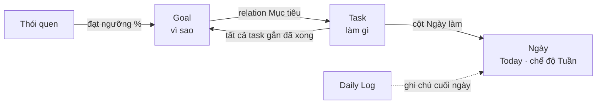
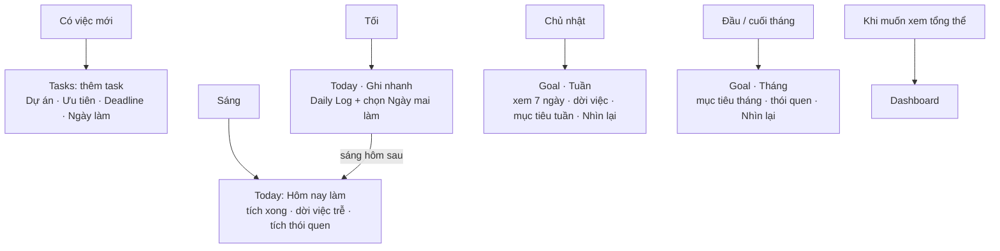
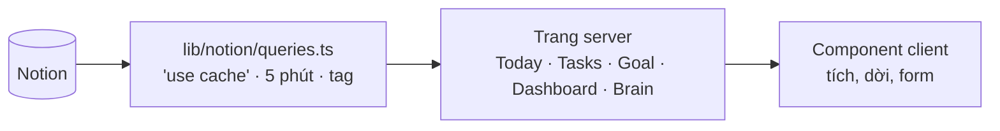
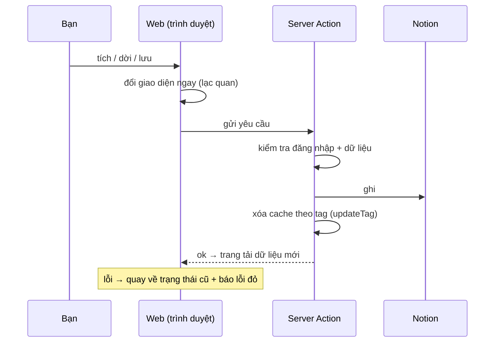

# Hướng dẫn sử dụng Brainrot

> Áp dụng từ **v0.5** (26/10/2026). Production: <https://brainrot-blue.vercel.app> (cần mật khẩu).
> Cài đặt, biến môi trường, cột Notion: xem [`README.md`](../README.md). Lý do thiết kế: [`SPEC-v0.5.md`](../SPEC-v0.5.md).

## 1. Ý tưởng chính

**Mọi việc chỉ nằm ở một chỗ: database Tasks trong Notion.** Các trang khác không tạo việc riêng, chỉ xếp lịch và
theo dõi cùng những task đó.

| Trang | Câu hỏi nó trả lời | Ghi gì lên Notion |
|---|---|---|
| **Tasks** | Tôi có những việc gì? | Tạo / sửa task (nơi **duy nhất** tạo việc) |
| **Today** | Hôm nay làm gì? | Tích xong, đặt Ngày làm, tích thói quen, Daily Log, ý tưởng |
| **Goal** | Tôi đang hướng tới điều gì? | Mục tiêu, Nhìn lại, châm ngôn, thói quen, dời Ngày làm |
| **Dashboard** | Tôi đang làm tốt không? | Không ghi gì (chỉ đọc) |
| **Brain** | Tôi biết những gì? | Không ghi gì (đọc Knowledge) |

Ba sợi dây nối các phần với nhau:

Hai ngày của một task — đừng nhầm:

- **Deadline** — ngày **phải xong**. Dùng cho cảnh báo quá hạn, thẻ "Sắp đến hạn", "Deadline 14 ngày tới".
- **Ngày làm** — ngày **định làm**. Dùng để xếp việc vào Today và 7 thẻ ngày. Đổi thoải mái, không ảnh hưởng Deadline.

## 2. Nhịp dùng hằng ngày / tuần / tháng

### 2.1 Có việc mới → Tasks

1. Gõ tên việc ở ô "Thêm task mới…".
2. Chọn **Dự án** và **Ưu tiên** (Cao / Vừa / Thấp).
3. Chọn **Deadline** nếu có hạn thật; chọn **Ngày làm** nếu đã biết sẽ làm hôm nào (không chắc thì để trống).
4. Bấm **Thêm** → task tạo trong Notion với Trạng thái "Chưa làm".
5. Muốn gắn vào mục tiêu: bấm **✎** trên dòng task → chọn **Goal** → Lưu. Chỉ hiện mục tiêu Tháng/Tuần hiện tại chưa xong.

Dòng task hiện "Làm: T4 28/10" — **đỏ** khi Ngày làm đã qua mà chưa xong, **xanh** khi là hôm nay.

### 2.2 Buổi sáng → Today

Khối **"Hôm nay làm"** tự gom, theo thứ tự:

1. Task chưa xong có **Ngày làm = hôm nay** (Ưu tiên Cao trước).
2. **Trễ lịch**: Ngày làm đã qua mà chưa xong → nút **"Dời sang hôm nay"**.
3. **Hạn hôm nay**: Deadline = hôm nay nhưng chưa xếp làm hôm nay → nút **"Làm hôm nay"**.
4. Cả ba trống → **gợi ý 3 task** ưu tiên cao nhất chưa xếp lịch, kèm nút "Làm hôm nay".

Thao tác:

- Tích ô vuông → Notion: Trạng thái = **Xong**, Ngày xong = hôm nay. Task gạch ngang tới lần tải lại.
- Cuối khối là **mục tiêu tuần Ưu tiên** (✓ khi xong, kể cả tự xong) — nhắc mình tuần này đang hướng tới gì.
- Thẻ **Thói quen hôm nay**: bấm từng thói quen đã làm → ghi vào Daily Log của hôm nay (tự tạo nếu chưa có).

Các thẻ khác chỉ để xem: đếm ngược đồ án, **Next up** (Google Calendar), **Deadline 14 ngày tới**, kiến thức mới.

### 2.3 Buổi tối → Today, khối Ghi nhanh

1. **Ý tưởng**: gõ một dòng → Lưu → database Ideas.
2. **Daily Log hôm nay**: ghi Xong / Rơi – chưa xong / Học được → Lưu (đã có thì Cập nhật, mỗi ngày một bản ghi).
3. **Ngày mai làm**: tích những task định làm ngày mai → Notion đặt Ngày làm = ngày mai. Bỏ tích = bỏ lịch.
   Danh sách gồm task đã xếp ngày mai + task chưa xếp lịch (ưu tiên cao trước).
4. Sáng hôm sau các task đó tự lên "Hôm nay làm"; việc nào không làm kịp sẽ thành **trễ lịch**.

### 2.4 Chủ nhật → Goal, chế độ Tuần

1. Bấm **Goal** trên sidebar → chọn **Tuần** (‹ › để đổi tuần, "Hôm nay" để về tuần hiện tại).
2. **Mục tiêu tuần**: thêm 1–3 mục tiêu **Ưu tiên** cho tuần tới (quá 3 có nhắc nhẹ), còn lại để **Thường**.
3. **7 ngày trong tuần**: mỗi thẻ là một ngày, gồm:
   - task có **Ngày làm** ngày đó, task **đã xong** ngày đó, task có **Deadline** ngày đó (nhãn đỏ "hạn");
   - ghi chú Xong / Rơi của Daily Log ngày đó;
   - % ngày = task xong / tổng (ngày chưa tới hiện "0/n" thay vì % đỏ).
   Việc cần đổi ngày → menu **"Dời sang…"** chọn ngày khác hoặc "Bỏ lịch". Tích xong cũng được ngay trên thẻ.
4. **Nhìn lại tuần**: 4 câu (làm tốt · bài học · biết ơn · 3 điều tập trung tuần sau) → Lưu.
   Câu 4 sẽ hiện ở đầu khối mục tiêu tuần sau ("Kỳ trước bạn định tập trung: …").

Trên điện thoại 7 thẻ thành danh sách dọc, ngày hôm nay mở sẵn; bấm tên ngày để mở / đóng.

### 2.5 Đầu / cuối tháng → Goal, chế độ Tháng

1. **Mục tiêu tháng**: thêm như mục tiêu tuần. Bấm 🔗 trên dòng mục tiêu để **gắn thói quen + ngưỡng %**
   (mặc định 80%) → mục tiêu **tự xong** khi % ngày làm thói quen trong tháng đạt ngưỡng.
2. **Tiến độ các tuần**: cột % mục tiêu của từng tuần trong tháng; bấm cột để mở tuần đó.
3. **Thói quen**: bảng cả tháng (tích được cho hôm nay và ngày đã qua), **Tổng kết tháng** (% · chuỗi · dài nhất),
   **Quản lý thói quen** (thêm, đổi thứ tự, ngừng từ tháng sau — lịch sử cũ giữ nguyên).
4. Cuối tháng: **Nhìn lại tháng**.

### 2.6 Đầu quý / năm → Goal, chế độ Quý và Năm

- **Quý**: mục tiêu quý + 3 thẻ tháng (vòng % và mục tiêu Ưu tiên của từng tháng).
- **Năm**: mục tiêu năm, cột % 4 quý + 12 tháng, 4 thẻ quý, **châm ngôn năm** (ô đầu tiên của Nhìn lại năm) —
  châm ngôn hiện ở đầu trang Goal và dưới tiêu đề Dashboard.
- Đổi cấp giữ ngữ cảnh: đang xem tháng 10 bấm **Năm** → ra năm của tháng 10.

### 2.7 Xem tổng thể → Dashboard

- Chọn kỳ **7 / 30 / 90 ngày**; **Thật / Mẫu** để xem bằng dữ liệu thật hoặc dữ liệu giả (khi dữ liệu thật còn ít).
- Hàng KPI: **Việc tồn** (quá hạn → đỏ), **Hoàn thành**, **Tuần này** (% task có Ngày làm trong tuần đã xong;
  "—" nếu chưa xếp lịch việc nào), **Đồ án** (còn bao nhiêu ngày).
- **Task theo dự án** (bấm cột → Tasks lọc dự án đó), **Mục tiêu tháng này**, **Sắp đến hạn** (14 ngày),
  **Nhịp làm & học** (12 tuần), **Brain** thu nhỏ, **Nhịp hằng ngày**, **Thói quen**.
- Khối nào thiếu nguồn thật thì tự dùng mẫu và có nhãn **"Mẫu"**.

### 2.8 Kiến thức → Brain

Thêm trang vào database **Knowledge** trong Notion (cần **Chủ đề** và **Lĩnh vực**; nên có Ngày học, Tóm tắt, Nguồn).
Trang Brain (`/`) và khối Brain trên Dashboard tự hiện node trong ≤ 5 phút. Kéo để xoay, cuộn để zoom, bấm cụm để
bay tới, ô tìm (phím `/`).

## 3. Luồng dữ liệu bên trong

### 3.1 Đọc

- Mọi lời gọi Notion nằm trong `lib/notion/` (chỉ chạy ở server). Mỗi loại dữ liệu có **cache 5 phút** và một tag
  (`tasks`, `knowledge`, `daily`, `habits`, `goals`, `reflections`).
- Notion lỗi → web hiện **bản gần nhất** kèm banner vàng và thử lại sau ~30 giây.
- Sửa trực tiếp trong Notion → web thấy sau tối đa **5 phút**.

### 3.2 Ghi

| Thao tác | Server Action | Ghi lên Notion |
|---|---|---|
| Tích task xong | `completeTask` | Tasks: Trạng thái = Xong, Ngày xong = hôm nay |
| Thêm / sửa task | `createTaskAction` / `updateTaskAction` | Tasks: các cột trong form (sửa → mở lại thì bỏ Ngày xong) |
| Làm hôm nay · Dời sang… · Ngày mai làm | `planTaskAction` | Tasks: Ngày làm (hoặc xóa) |
| Tích thói quen | `setDayHabitsAction` | Daily Log của ngày đó: Thói quen (+ ô Tập thể dục cũ) |
| Daily Log | `saveDailyLogAction` | Daily Log hôm nay: Xong · Rơi · Học được |
| Ý tưởng | `addIdeaAction` | Ideas: trang mới |
| Mục tiêu | `createGoalAction` / `updateGoalAction` / `trashGoalAction` | Goals (xóa = chuyển vào Trash, hoàn tác trong 5 giây) |
| Nhìn lại / châm ngôn | `saveReflectionAction` | Reflections: 1 bản ghi / kỳ (có thì cập nhật) |
| Thêm / ngừng / đổi thứ tự thói quen | `addHabitAction` / `stopHabitAction` / `moveHabitAction` | Habits |

### 3.3 Mục tiêu "tự xong"

Một mục tiêu được tính là xong khi **một trong ba**:

1. Bạn **tích tay**;
2. Có gắn thói quen và **% ngày làm thói quen trong kỳ ≥ ngưỡng** (tính trên số ngày đã qua của kỳ);
3. Có task gắn (relation "Mục tiêu" ở Tasks) và **tất cả task đó đã Xong**.

Trường hợp 2–3 hiện chip xanh "tự xong" và chip tiến độ (vd. "Tập thể dục 72% / 80%", "2/3 task"); không ghi gì lên
Notion — chỉ tính lúc hiển thị.

## 4. Câu hỏi thường gặp

| Hỏi | Đáp |
|---|---|
| Việc tạo trong Notion có hiện trên web không? | Có, sau tối đa 5 phút. Nên tạo trên web để thấy ngay. |
| Không đặt Ngày làm thì task ở đâu? | Ở Tasks; lên Today khi Deadline là hôm nay hoặc khi được gợi ý lúc "Hôm nay làm" trống. |
| Xóa task thế nào? | Xóa trong Notion (web không xóa task). |
| Planner đâu rồi? | Bỏ từ v0.5; `/planner` tự chuyển sang Goal → Tuần. Xếp việc theo ngày bằng **Ngày làm**. |
| Ô "Ngày mai 3 việc" cũ đâu? | Thay bằng **Ngày mai làm** (chọn task). Chữ cũ vẫn còn trong cột Notion. |
| Một khối báo "Chưa kết nối database …" | Thiếu biến môi trường `NOTION_*_DB` tương ứng trên Vercel → thêm rồi Redeploy. |
| Đổi máy / điện thoại có mất dữ liệu không? | Không — mọi dữ liệu nằm trong Notion. Chỉ lựa chọn giao diện (sáng/tối, Thật/Mẫu, kỳ) lưu theo trình duyệt. |
