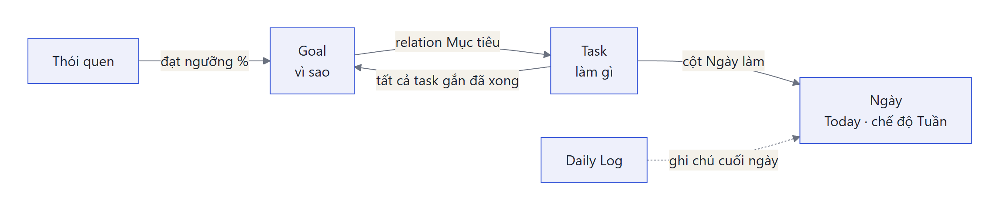
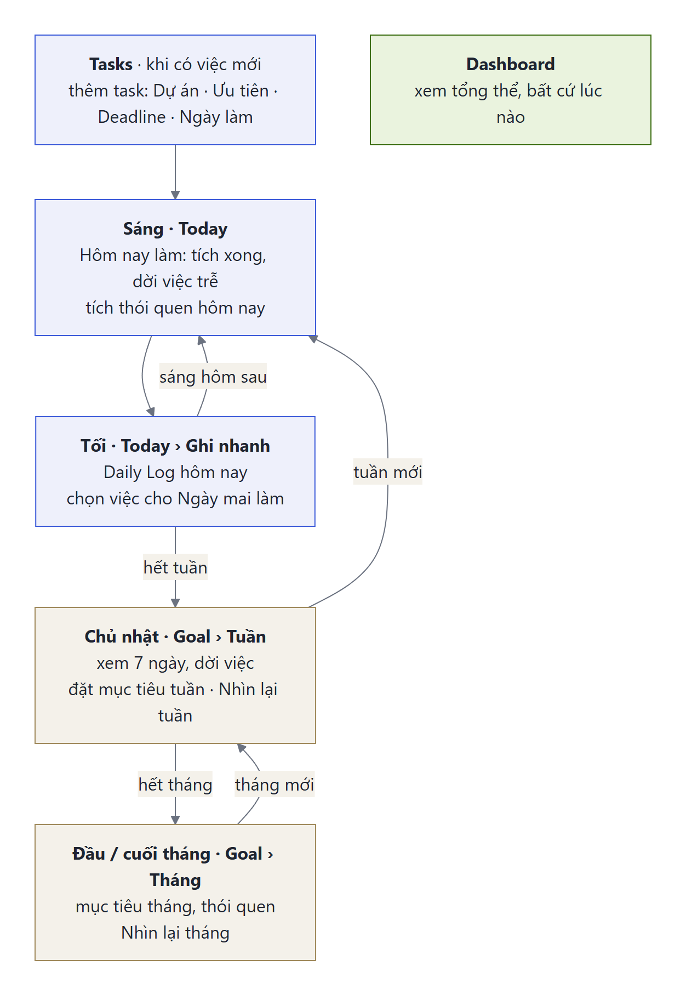

# Hướng dẫn sử dụng Brainrot

> Áp dụng cho **v1.1** (12/11/2026). Production: <https://brainrot-blue.vercel.app> (đăng nhập email + mật khẩu).
> Cài đặt, biến môi trường, database: xem [`README.md`](../README.md). Phạm vi và hành vi sản phẩm: [`SPEC.md`](../SPEC.md).
> Sơ đồ là ảnh PNG; nguồn mermaid để sửa nằm cạnh ảnh trong [`images/huong-dan/`](images/huong-dan/) (`*.mmd`).

## 1. Ý tưởng chính

**Mọi việc chỉ nằm ở một chỗ: bảng Tasks.** Các trang khác không tạo việc riêng, chỉ xếp lịch và
theo dõi cùng những task đó.

| Trang | Câu hỏi nó trả lời | Ghi gì vào database |
|---|---|---|
| **Tasks** | Tôi có những việc gì? | Tạo / sửa task (nơi **duy nhất** tạo việc) |
| **Today** | Hôm nay làm gì? | Tích xong, đặt Ngày làm, tích thói quen, Daily Log, ý tưởng |
| **Goal** | Tôi đang hướng tới điều gì? | Mục tiêu, Nhìn lại, châm ngôn, thói quen, dời Ngày làm |
| **Dashboard** | Tôi đang làm tốt không? | Không ghi gì (chỉ đọc) |
| **Knowledge** | Tôi đã học được gì? | Ghi chú kiến thức, liên kết giữa các ghi chú |
| **Brain** | Mọi thứ nối với nhau thế nào? | Không ghi gì (chỉ xem graph) |

Ba sợi dây nối các phần với nhau:



Hai ngày của một task — đừng nhầm:

- **Deadline** — ngày **phải xong**. Dùng cho cảnh báo quá hạn, thẻ "Sắp đến hạn", "Deadline 14 ngày tới".
- **Ngày làm** — ngày **định làm**. Dùng để xếp việc vào Today và 7 thẻ ngày. Đổi thoải mái, không ảnh hưởng Deadline.

## 2. Nhịp dùng hằng ngày / tuần / tháng



### 2.1 Có việc mới → Tasks

1. Gõ tên việc ở ô "Thêm việc mới…".
2. Chọn **Dự án** và **Ưu tiên** (Cao / Vừa / Thấp).
3. Chọn **Deadline** nếu có hạn thật; chọn **Ngày làm** nếu đã biết sẽ làm hôm nào (không chắc thì để trống).
4. Bấm **Thêm** → task được tạo với Trạng thái "Chưa làm".
5. Muốn gắn vào mục tiêu: bấm **✎** trên dòng task → chọn **Goal** → Lưu. Chỉ hiện mục tiêu Tháng/Tuần hiện tại chưa xong.

Dòng task hiện "Làm: T4 28/10" — **đỏ** khi Ngày làm đã qua mà chưa xong, **xanh** khi là hôm nay.

### 2.2 Buổi sáng → Today

Khối **"Hôm nay làm"** tự gom, theo thứ tự:

1. Task chưa xong có **Ngày làm = hôm nay** (Ưu tiên Cao trước).
2. **Trễ lịch**: Ngày làm đã qua mà chưa xong → nút **"Làm hôm nay"**.
3. **Hạn hôm nay**: Deadline = hôm nay nhưng chưa xếp làm hôm nay → nút **"Làm hôm nay"**.
4. Cả ba trống → **gợi ý 3 task** ưu tiên cao nhất chưa xếp lịch, kèm nút "Làm hôm nay".

Thao tác:

- Tích ô vuông → Trạng thái = **Xong**, Ngày xong = hôm nay. Task gạch ngang tới lần tải lại.
- Cuối khối là **mục tiêu tuần Ưu tiên** (✓ khi xong, kể cả tự xong) — nhắc mình tuần này đang hướng tới gì.
- Thẻ **Thói quen · 7 ngày**: bấm ô của từng thói quen ở ngày đã làm → lưu ngay.

Các phần khác chỉ để xem: dòng đếm ngược dưới lời chào và thẻ **Hạn · 14 ngày** (không lặp việc đã nằm trong "Hôm nay làm").
Thẻ **Kiến thức mới** liệt kê 5 ghi chú mới nhất (bấm tên mở Knowledge). Next up (Google Calendar) không có trong sản phẩm.

### 2.3 Buổi tối → Today, Ghi nhanh và Cuối ngày

1. **Ý tưởng**: gõ một dòng → Lưu → database Ideas.
2. **Daily Log hôm nay**: ghi Xong / Chưa xong / Học được → Lưu (đã có thì Cập nhật, mỗi ngày một bản ghi).
3. **Ngày mai làm**: tích những task định làm ngày mai → đặt Ngày làm = ngày mai. Bỏ tích = bỏ lịch.
   Danh sách gồm task đã xếp ngày mai + task chưa xếp lịch (ưu tiên cao trước).
4. Sáng hôm sau các task đó tự lên "Hôm nay làm"; việc nào không làm kịp sẽ thành **trễ lịch**.

### 2.4 Chủ nhật → Goal, chế độ Tuần

1. Bấm **Goal** trên sidebar → chọn **Tuần** (‹ › để đổi tuần, "Hôm nay" để về tuần hiện tại).
2. **Mục tiêu tuần**: thêm 1–3 mục tiêu **Ưu tiên** cho tuần tới (quá 3 có nhắc nhẹ), còn lại để **Thường**.
3. **7 ngày trong tuần**: mỗi thẻ là một ngày, gồm:
   - task có **Ngày làm** ngày đó, task **đã xong** ngày đó, task có **Deadline** ngày đó (nhãn đỏ "hạn");
   - ghi chú Xong / Chưa xong của Daily Log ngày đó;
   - % ngày = task xong / tổng (ngày chưa tới hiện "0/n" thay vì % đỏ).
   Việc cần đổi ngày → menu **"Dời sang…"** chọn ngày khác hoặc "Bỏ lịch". Tích xong cũng được ngay trên thẻ.
4. **Nhìn lại tuần**: 4 câu (làm tốt · bài học · biết ơn · 3 điều tập trung tuần sau) → Lưu.
   Câu 4 sẽ hiện ở đầu khối mục tiêu tuần sau ("Kỳ trước bạn định tập trung: …").

Trên điện thoại 7 thẻ thành danh sách dọc, ngày hôm nay mở sẵn; bấm tên ngày để mở / đóng.

### 2.5 Đầu / cuối tháng → Goal, chế độ Tháng

1. **Mục tiêu tháng**: thêm như mục tiêu tuần. Bấm 🔗 trên dòng mục tiêu để **gắn thói quen + ngưỡng %**
   (mặc định 80%) → mục tiêu **tự xong** khi % ngày làm thói quen trong tháng đạt ngưỡng.
2. **Tiến độ các tuần**: cột % mục tiêu của từng tuần trong tháng; bấm cột để mở tuần đó.
3. **Thói quen**: bảng cả tháng (tích được cho hôm nay và ngày đã qua), **Tổng kết tháng** (% · chuỗi · dài nhất),
   **Quản lý thói quen** (thêm, đổi thứ tự, ngừng từ tháng sau — lịch sử cũ giữ nguyên).
4. Cuối tháng: **Nhìn lại tháng**.

### 2.6 Đầu quý / năm → Goal, chế độ Quý và Năm

- **Quý**: mục tiêu quý + 3 thẻ tháng (vòng % và mục tiêu Ưu tiên của từng tháng).
- **Năm**: mục tiêu năm, cột % 4 quý + 12 tháng, 4 thẻ quý, **châm ngôn năm** (ô đầu tiên của Nhìn lại năm) —
  châm ngôn hiện ở đầu trang Goal và dưới tiêu đề Dashboard.
- Đổi cấp giữ ngữ cảnh: đang xem tháng 10 bấm **Năm** → ra năm của tháng 10.

### 2.7 Xem tổng thể → Dashboard

- Chọn kỳ **7 / 30 / 90 ngày**; **Thật / Mẫu** để xem bằng dữ liệu thật hoặc dữ liệu giả (khi dữ liệu thật còn ít).
- Hàng KPI: **Việc tồn** (quá hạn → đỏ), **Hoàn thành**, **Tuần này** (% task có Ngày làm trong tuần đã xong;
  "—" nếu chưa xếp lịch việc nào), **Đồ án** (còn bao nhiêu ngày).
- **Task theo dự án** (bấm cột → Tasks lọc dự án đó), **Mục tiêu tháng này**, **Sắp đến hạn** (14 ngày),
  **Nhịp làm & học** (việc xong và ghi chú mới mỗi tuần, 12 tuần), **Nhịp hằng ngày**, **Thói quen**.
- Ở chế độ Thật, khối nào chưa có dữ liệu thì gom vào khung **"Chưa có dữ liệu"** cuối trang kèm link tới chỗ thêm
  (không tự lấp bằng dữ liệu mẫu). Chế độ Mẫu có một dải thông báo đầu trang và nút "Về dữ liệu thật".

### 2.8 Học được gì → Knowledge

1. Lần đầu: vào **Cài đặt → Lĩnh vực**, thêm vài lĩnh vực (vd. Computer Vision, Nhúng, Đồ án). 4 lĩnh vực đầu có màu riêng.
2. Ở **Knowledge**, gõ tên điều vừa học, chọn **Lĩnh vực** và **Mức hiểu** (Mới học / Hiểu / Áp dụng được) → **Thêm**.
3. Bấm **✎** trên ghi chú để thêm **Tóm tắt**, **Nguồn** (link http/https), **Ngày học** và **Liên quan tới**: gõ tìm
   (không cần dấu) rồi chọn ghi chú khác; liên kết là hai chiều.
4. Lọc theo Lĩnh vực / Mức hiểu (nằm trên URL, gửi link là giữ bộ lọc), ô **Tìm** khớp tên và tóm tắt.
5. Xoá ghi chú có nút **Hoàn tác** 8 giây (khôi phục cả liên kết).

5 ghi chú mới nhất hiện ở thẻ **Kiến thức mới** trên Today; số ghi chú mỗi tuần hiện ở **Nhịp làm & học** trên Dashboard.

### 2.9 Nhìn toàn cảnh → Brain

- Graph 3D: mỗi **Lĩnh vực** và **Dự án** là một cụm có tên; ghi chú nối về lĩnh vực, việc chưa xong nối về dự án, các ghi
  chú "liên quan tới" nhau nối bằng sợi cong có hạt chạy. Lĩnh vực là nhân đặc, Dự án là nhân rỗng có khung lưới.
- Kéo để xoay, cuộn để zoom; bấm chip ở chân khung hoặc bấm cụm để bay tới.
- Phím **/** mở ô tìm (không cần dấu) → Enter để bay tới và làm nổi node cùng các node nối trực tiếp; Esc để bỏ.
- Bấm một ghi chú mở Knowledge, bấm một việc mở Tasks.
- Khung Brain luôn nền tối ở cả hai theme để các neuron phát sáng rõ.

## 3. Luồng dữ liệu bên trong

### 3.1 Đọc

- Mọi truy vấn nằm trong `lib/db/` (chỉ chạy ở server) và luôn lọc theo người đang đăng nhập (`userId` lấy từ cookie
  đã ký, không bao giờ từ form hay URL).
- Không có cache dữ liệu: mỗi lần mở trang đọc thẳng Postgres, nên luôn thấy bản mới nhất.

### 3.2 Ghi

Bạn thao tác → giao diện đổi ngay (lạc quan) → Server Action ghi vào Postgres → tải lại trang. Lỗi thì giao diện trả
về như cũ và báo lỗi.

| Thao tác | Server Action | Ghi vào bảng |
|---|---|---|
| Tích task xong | `completeTask` | Tasks: Trạng thái = Xong, Ngày xong = hôm nay |
| Thêm / sửa task | `createTaskAction` / `updateTaskAction` | Tasks: các cột trong form (sửa → mở lại thì bỏ Ngày xong) |
| Làm hôm nay · Dời sang… · Ngày mai làm | `planTaskAction` | Tasks: Ngày làm (hoặc xóa) |
| Tích thói quen | `setDayHabitsAction` | habit_days: các thói quen đã làm trong ngày |
| Daily Log | `saveDailyLogAction` | Daily Log hôm nay: Xong · Chưa xong · Học được |
| Ý tưởng | `addIdeaAction` | Ideas: dòng mới |
| Mục tiêu | `createGoalAction` / `updateGoalAction` / `trashGoalAction` | Goals (xóa mềm, hoàn tác trong 8 giây) |
| Nhìn lại / châm ngôn | `saveReflectionAction` | Reflections: 1 bản ghi / kỳ (có thì cập nhật) |
| Thêm / ngừng / đổi thứ tự thói quen | `addHabitAction` / `stopHabitAction` / `moveHabitAction` | Habits |
| Ghi chú kiến thức | `createNoteAction` / `updateNoteAction` / `deleteNoteAction` / `restoreNoteAction` | knowledge, knowledge_links |
| Lĩnh vực | `createFieldAction` / `renameFieldAction` / `deleteFieldAction` | fields |

### 3.3 Mục tiêu "tự xong"

Một mục tiêu được tính là xong khi **một trong ba**:

1. Bạn **tích tay**;
2. Có gắn thói quen và **% ngày làm thói quen trong kỳ ≥ ngưỡng** (tính trên số ngày đã qua của kỳ);
3. Có task gắn (ô Goal khi sửa task) và **tất cả task đó đã Xong**.

Trường hợp 2–3 hiện chip xanh "tự xong" và chip tiến độ (vd. "Tập thể dục 72% / 80%", "2/3 task"); không ghi gì vào
database — chỉ tính lúc hiển thị.

## 4. Câu hỏi thường gặp

| Hỏi | Đáp |
|---|---|
| Không đặt Ngày làm thì task ở đâu? | Ở Tasks; lên Today khi Deadline là hôm nay hoặc khi được gợi ý lúc "Hôm nay làm" trống. |
| Xóa task thế nào? | Ở Tasks, bấm icon thùng rác cuối dòng: việc biến mất ngay, có thông báo nhỏ với nút **Hoàn tác** 8 giây ở cuối màn hình (rê chuột vào thì dừng đếm; xoá nhiều việc liên tiếp thì mỗi việc một thông báo). |
| Tích nhầm ở Today? | Việc vừa tích vẫn ở nguyên chỗ, gạch ngang: bấm lại ô tích hoặc nút **Hoàn tác** trên thông báo để mở lại. |
| Planner đâu rồi? | Bỏ từ v0.5; `/planner` tự chuyển sang Goal → Tuần. Xếp việc theo ngày bằng **Ngày làm**. |
| Đổi máy / điện thoại có mất dữ liệu không? | Không — mọi dữ liệu nằm trong database (Neon), theo tài khoản. Chỉ lựa chọn giao diện (sáng/tối, Thật/Mẫu, kỳ) lưu theo trình duyệt. |

## 5. Cài đặt và tài khoản

- **Cài đặt** (mục cuối sidebar): tên hiển thị, hạn cần đếm ngược + tên của hạn, **dự án** của riêng bạn (thêm / đổi tên /
  xóa khi không còn việc), **lĩnh vực** (tương tự, xóa khi không còn ghi chú), đổi mật khẩu, xóa tài khoản (xóa **toàn bộ** dữ liệu, không hoàn tác).
- **Đăng xuất**: nút ở chân sidebar.
- Sai mật khẩu **5 lần** trong 15 phút thì email đó bị khóa tạm 15 phút.

### Dành cho Trung: tạo tài khoản cho một bạn

```bash
npm run user:password -- ban@example.com "Tên bạn"
```

Lệnh hỏi mật khẩu (không hiện khi gõ), tạo người dùng mới kèm dự án "Chung". Gửi email + mật khẩu cho bạn, nhắc đổi mật khẩu ở
Cài đặt. Quên mật khẩu: chạy lại đúng lệnh đó với email của bạn để đặt mật khẩu mới. Mỗi người chỉ thấy dữ liệu của mình.
Chống dò mật khẩu cần chạy `npm run db:migrate` một lần (migration `0003`).
